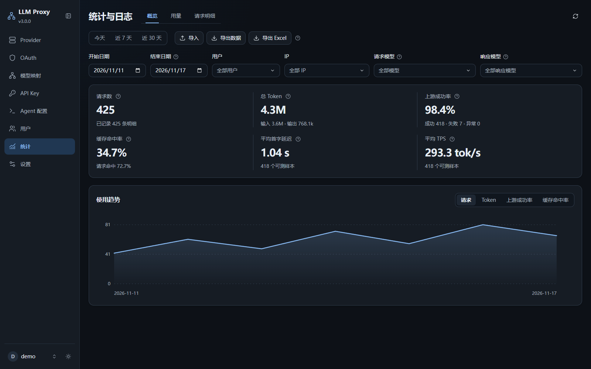
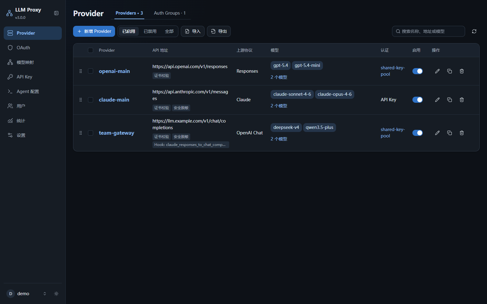
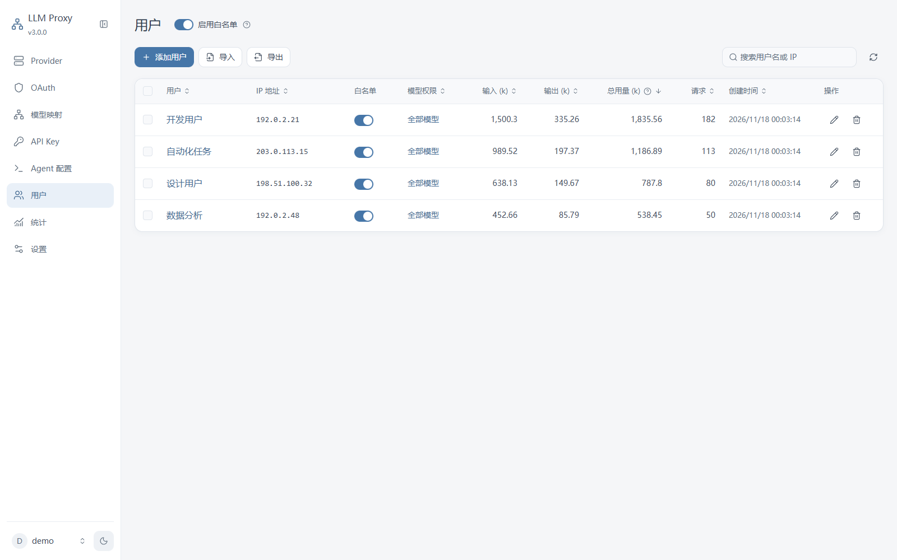

<div align="center">

<h1>LLM_Proxy</h1>

<p><strong>一个入口，连接你的所有模型。</strong></p>

<p>
  面向个人与团队的自托管 LLM API 网关。<br>
  统一接入 OpenAI、Claude 与兼容上游，在一个后台完成路由、认证、转换、观测与扩展。
</p>

<p>
  <a href="README_EN.md"><strong>English</strong></a> ·
  <a href="#-快速开始">快速开始</a> ·
  <a href="docs/user-guide.md">完整使用手册</a> ·
  <a href="docs/architecture-4plus1.md">架构文档</a>
</p>

<a href="https://github.com/VonSdite/LLM_Proxy/stargazers">
  
</a>
<a href="https://github.com/VonSdite/LLM_Proxy/network/members">
  
</a>


<br><br>



<p><sub>统计概览与 Token 用量趋势 · 截图使用合成演示数据</sub></p>

</div>

## ✨ 核心能力

| 能力 | 说明 |
| --- | --- |
| **🔀 多协议网关** | 同时提供 OpenAI Chat Completions、OpenAI Responses、Claude Messages 与图片接口；内置跨协议请求、响应和流式事件转换。 |
| **🧭 灵活模型路由** | 支持 `provider/model` 路由、自定义模型映射、多目标优先级与粘滞故障切换、目标冷却和模型可见性管理。 |
| **🔑 凭据池与 OAuth** | Auth Group 提供多 Key 调度、并发与请求配额、429 冷却；Codex OAuth 支持认证文件管理、账号切换与状态跟踪。 |
| **🛡️ 访问控制与脱敏** | 提供下游 API Key、模型权限、Token 配额、并发与分钟/每日限制、IP 白名单，以及可选的请求级安全脱敏。 |
| **📊 用量可观测** | 查看请求趋势、Token、缓存命中、上游成功率、首字延迟、TPS 与费用；趋势按日期范围提供 5 分钟、小时和天粒度切换，支持请求、映射、响应模型独立筛选，统计表格列宽自适应，以及 Excel 和数据迁移导出。 |
| **🧩 扩展与 Agent 集成** | 通过 Hook 定制 Header、请求、响应和模型发现；使用页面注册表和受控 Python 动作扩展管理端；集中维护 Claude、Codex、opencode、Hermes 的本机或 SSH 配置。 |

Provider 编辑页还支持模型发现、可用性测试、首字延迟与 TPS 测量，配置可直接在管理后台维护。

## 🖥️ 管理界面

| Provider 与认证组 | 用户与访问控制 |
| --- | --- |
| [](docs/images/providers.png) | [](docs/images/users.png) |
| 上游协议、模型、认证池、Hook 与启停状态集中管理。 | 用户模型权限、IP 白名单与累计用量清晰可查。 |

管理界面基于 Vue 3，支持深色与浅色主题，需要支持原生 Import Map 的现代浏览器。生产构建资源已包含在仓库中，运行服务无需安装 Node.js。

## 🚀 快速开始

### 环境要求

- Python **3.12+**
- [uv](https://docs.astral.sh/uv/)
- 一个可用的上游 API Key

### 1. 获取项目并安装依赖

```bash
git clone https://github.com/VonSdite/LLM_Proxy.git
cd LLM_Proxy
uv sync
```

### 2. 创建 `config.yaml`

```yaml
server:
  host: 127.0.0.1
  port: 8080

admin:
  username: admin
  password: change-me-before-start

providers:
  - name: openai
    api: https://api.openai.com/v1/chat/completions
    source_format: openai_chat
    api_key: sk-your-openai-key
    verify_ssl: true
    model_list:
      - gpt-4.1
      - gpt-4.1-mini
```

启动前替换管理密码和上游 API Key。更多 Provider、Auth Group、OAuth 与功能开关见 [配置样例](config.sample.yaml) 和 [完整使用手册](docs/user-guide.md)。

### 3. 启动服务

```bash
uv run python main.py
```

打开管理后台：[http://127.0.0.1:8080](http://127.0.0.1:8080)。

也可指定其他配置文件：

```bash
uv run python main.py --config path/to/config.yaml
```

### 4. 发送第一条请求

```bash
curl http://127.0.0.1:8080/v1/chat/completions \
  -H "Content-Type: application/json" \
  -d '{
    "model": "openai/gpt-4.1",
    "messages": [
      {"role": "user", "content": "用一句话介绍 LLM_Proxy"}
    ],
    "stream": false
  }'
```

## 🔌 API 与模型命名

| 接口 | 用途 |
| --- | --- |
| `POST /v1/chat/completions` | OpenAI Chat Completions 兼容请求 |
| `POST /v1/responses` | OpenAI Responses 兼容请求 |
| `POST /v1/responses/compact` | Codex OAuth 上下文压缩 |
| `POST /v1/messages` | Claude Messages 兼容请求 |
| `POST /v1/images/generations` | 图片生成 |
| `POST /v1/images/edits` | 图片编辑 |
| `GET /v1/models` | 查询当前可用模型 |

模型 ID 按来源使用三种形式：

| 来源 | 示例 |
| --- | --- |
| 常规 Provider | `openai/gpt-4.1` |
| Codex OAuth | `gpt-5.4` |
| 自定义模型映射 | `smart`、`coding-fast` |

开启下游 API Key 管理后，请求需携带 `Authorization: Bearer <your-downstream-api-key>`，并满足 Key 的模型权限与配额限制。

## 📚 文档导航

| 文档 | 内容 |
| --- | --- |
| [完整使用手册](docs/user-guide.md) | Provider、Auth Group、OAuth、Hook、安全脱敏与配置参考 |
| [Agent 配置与兼容性](docs/agent-configuration.md) | Agent 声明式扩展、文件格式、路径、SSH 与参数说明 |
| [管理端扩展开发](docs/extension-development.md) | 页面注册表、扩展页宿主、Python 动作接口与安全边界 |
| [统计口径](docs/statistics-design.md) | 请求结果、Token、缓存与性能指标定义 |
| [LLM 数据记录](docs/llm-recording.md) | 请求输入输出归档、去重、分片与存储边界 |
| [前端开发指南](docs/frontend-development.md) | Vue 组件、开发、测试与生产构建 |
| [4+1 架构](docs/architecture-4plus1.md) | 分层职责、运行时状态与主请求链路 |

## 🛠️ 前端开发

仅在修改管理界面时需要 Node.js 24：

```bash
npm --prefix frontend ci
npm --prefix frontend run dev
```

开发服务器位于 `http://127.0.0.1:5173`，API 默认代理到 `http://127.0.0.1:8080`。

发布前执行 `npm --prefix frontend run build`，并提交完整构建产物。分块使用独立导入映射，单页修改通常只影响相关资源和清单；部署端通过 `git pull` 获取产物即可。详见 [前端开发指南](docs/frontend-development.md#5-构建与部署)。

## 🔐 安全提示

- 服务默认监听 `127.0.0.1`；开放局域网或公网访问时，请配置强管理密码、下游 API Key 与合适的网络访问控制。
- `config.yaml`、OAuth 认证文件、SQLite 数据库、Trace 日志和 LLM 数据记录均可能包含敏感内容，应限制文件访问并避免提交到版本库。
- 公网 HTTPS 上游建议设置 `verify_ssl: true`。
- 安全脱敏采用规则型假名化，适用边界与覆盖范围见 [完整使用手册](docs/user-guide.md#7-安全脱敏)。
- 请仅在获得授权的前提下访问上游账号与 API，并遵守对应服务条款。

## 🤝 参与贡献

欢迎提交 Issue 与 Pull Request，分享协议兼容、Provider 接入、界面体验和文档改进。前端修改请同时阅读 [前端开发指南](docs/frontend-development.md)。

---

<div align="center">
  <strong>如果 LLM_Proxy 对你有帮助，欢迎 Star 支持。</strong><br><br>
  <a href="README_EN.md">English</a> ·
  <a href="docs/user-guide.md">使用手册</a> ·
  <a href="https://github.com/VonSdite/LLM_Proxy/issues">反馈问题</a>
</div>
