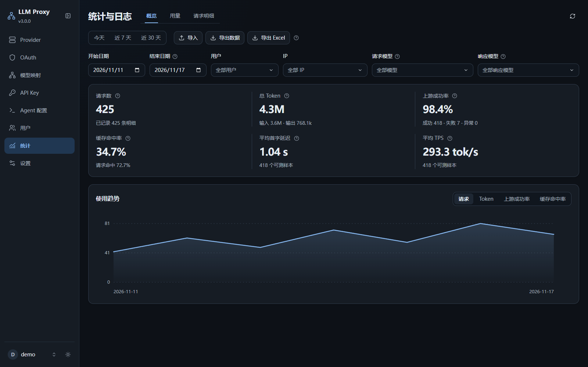
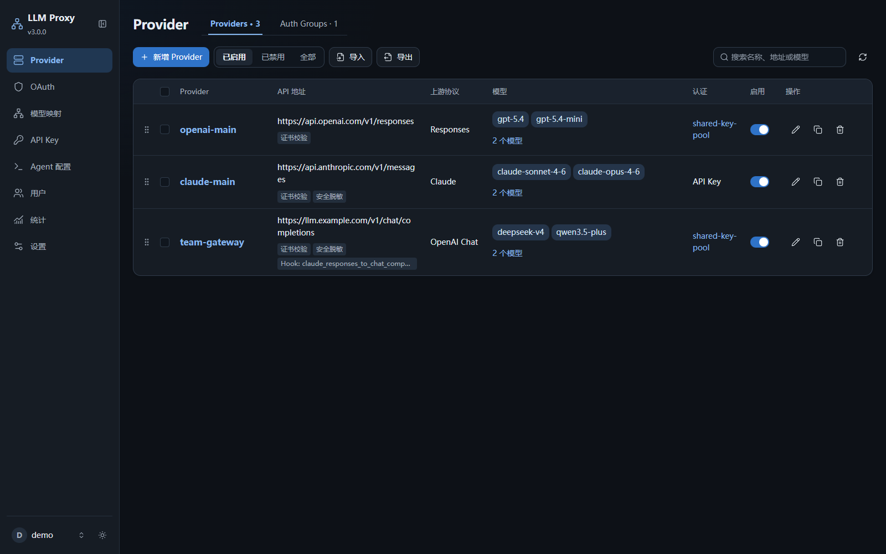
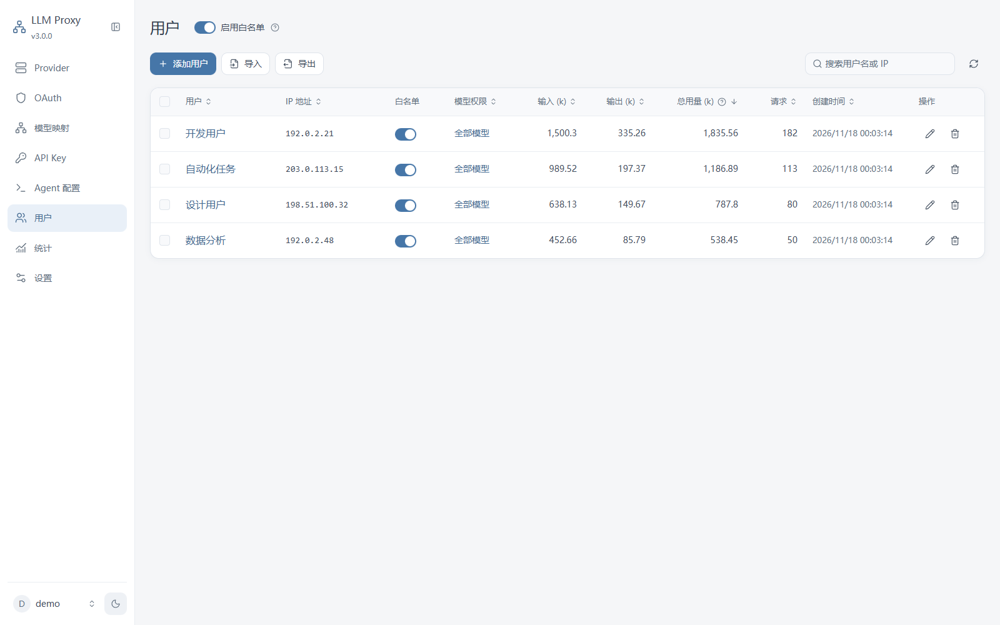

<div align="center">

<h1>LLM_Proxy</h1>

<p><strong>One gateway for all your models.</strong></p>

<p>
  A self-hosted LLM API gateway for individuals and teams.<br>
  Connect OpenAI, Claude, and compatible upstreams with unified routing, authentication, translation, observability, and extensions.
</p>

<p>
  <a href="README.md"><strong>简体中文</strong></a> ·
  <a href="#-quick-start">Quick Start</a> ·
  <a href="docs/user-guide.md">Full User Guide (Chinese)</a> ·
  <a href="docs/architecture-4plus1.md">Architecture (Chinese)</a>
</p>

<a href="https://github.com/VonSdite/LLM_Proxy/stargazers">
  
</a>
<a href="https://github.com/VonSdite/LLM_Proxy/network/members">
  
</a>


<br><br>



<p><sub>Usage overview and request trends · Screenshots contain synthetic demo data only</sub></p>

</div>

## ✨ Features

| Capability | Description |
| --- | --- |
| **🔀 Multi-protocol gateway** | Serve OpenAI Chat Completions, OpenAI Responses, Claude Messages, and image APIs from one service, with built-in request, response, and streaming event translation. |
| **🧭 Flexible model routing** | Use `provider/model` routes, custom model mappings, prioritized or sticky multi-target failover, target cooldowns, and per-model visibility controls. |
| **🔑 Credential pools and OAuth** | Schedule multiple keys with concurrency and request quotas, 429 cooldowns, and Auth Groups. Manage Codex OAuth files, account failover, and runtime status. |
| **🛡️ Access control and redaction** | Configure downstream API keys, model permissions, token quotas, concurrency and per-minute/daily limits, IP allowlists, and optional request-scoped sensitive-data redaction. |
| **📊 Usage observability** | Inspect request trends, tokens, cache hits, upstream success rates, first-token latency, TPS, and costs. Filter across dimensions and export request details, Excel files, or migration data. |
| **🧩 Extensions and Agent integration** | Customize headers, requests, responses, and model discovery with Hooks. Extend the admin interface with registered pages and controlled Python actions. Manage local or SSH-based Claude, Codex, opencode, DSH, and Hermes configurations. |

The Provider editor also includes model discovery, availability checks, first-token latency measurements, and TPS tests.

## 🖥️ Admin Interface

| Providers and Auth Groups | Users and Access Control |
| --- | --- |
| [](docs/images/providers.png) | [](docs/images/users.png) |
| Manage upstream protocols, models, credential pools, Hooks, and availability in one place. | Review model permissions, IP allowlists, and cumulative usage by user. |

The Vue 3 admin interface supports dark and light themes. Production assets are included in the repository, so Node.js is not required to run the service.

## 🚀 Quick Start

### Prerequisites

- Python **3.12+**
- [uv](https://docs.astral.sh/uv/)
- A valid upstream API key

### 1. Clone and install

```bash
git clone https://github.com/VonSdite/LLM_Proxy.git
cd LLM_Proxy
uv sync
```

### 2. Create `config.yaml`

```yaml
server:
  host: 127.0.0.1
  port: 8080

admin:
  username: admin
  password: change-me-before-start

providers:
  - name: openai
    api: https://api.openai.com/v1/chat/completions
    source_format: openai_chat
    api_key: sk-your-openai-key
    verify_ssl: true
    model_list:
      - gpt-4.1
      - gpt-4.1-mini
```

Replace the admin password and upstream API key before starting. See the [sample configuration](config.sample.yaml) and [full user guide](docs/user-guide.md) for Providers, Auth Groups, OAuth, and feature switches.

### 3. Start the service

```bash
uv run python main.py
```

Open the admin interface at [http://127.0.0.1:8080](http://127.0.0.1:8080).

To use a different configuration file:

```bash
uv run python main.py --config path/to/config.yaml
```

### 4. Send your first request

```bash
curl http://127.0.0.1:8080/v1/chat/completions \
  -H "Content-Type: application/json" \
  -d '{
    "model": "openai/gpt-4.1",
    "messages": [
      {"role": "user", "content": "Introduce LLM_Proxy in one sentence"}
    ],
    "stream": false
  }'
```

## 🔌 APIs and Model IDs

| Endpoint | Purpose |
| --- | --- |
| `POST /v1/chat/completions` | OpenAI Chat Completions compatible requests |
| `POST /v1/responses` | OpenAI Responses compatible requests |
| `POST /v1/responses/compact` | Context compaction through Codex OAuth |
| `POST /v1/messages` | Claude Messages compatible requests |
| `POST /v1/images/generations` | Image generation |
| `POST /v1/images/edits` | Image editing |
| `GET /v1/models` | List currently available models |

Model IDs use three forms depending on their source:

| Source | Examples |
| --- | --- |
| Standard Provider | `openai/gpt-4.1` |
| Codex OAuth | `gpt-5.4` |
| Custom model mapping | `smart`, `coding-fast` |

When downstream API key management is enabled, requests must include `Authorization: Bearer <your-downstream-api-key>` and satisfy the key's model permissions and quotas.

## 📚 Documentation

| Document | Contents |
| --- | --- |
| [Full User Guide (Chinese)](docs/user-guide.md) | Providers, Auth Groups, OAuth, Hooks, redaction, and configuration reference |
| [Agent Configuration](docs/agent-configuration.md) | Declarative Agent extensions, file formats, paths, SSH, and parameters |
| [Admin Extension Development](docs/extension-development.md) | Page registry, extension page host, Python action APIs, and security boundaries |
| [Statistics Metrics](docs/statistics-design.md) | Request outcomes, tokens, cache, and performance metric definitions |
| [LLM Data Recording](docs/llm-recording.md) | Input/output archiving, deduplication, sharding, and storage boundaries |
| [Frontend Development](docs/frontend-development.md) | Vue components, development, testing, and production builds |
| [4+1 Architecture](docs/architecture-4plus1.md) | Layer responsibilities, runtime state, and primary request flows |

The linked topic documents are primarily written in Chinese.

## 🛠️ Frontend Development

Node.js 24 is required only when modifying the admin interface:

```bash
npm --prefix frontend ci
npm --prefix frontend run dev
```

The development server runs at `http://127.0.0.1:5173` and proxies API requests to `http://127.0.0.1:8080` by default.

## 🔐 Security Notes

- The service listens on `127.0.0.1` by default. For LAN or public deployments, configure a strong admin password, downstream API keys, and appropriate network access controls.
- `config.yaml`, OAuth credentials, the SQLite database, trace logs, and LLM records can contain sensitive data. Restrict file access and keep them out of version control.
- Use `verify_ssl: true` for public HTTPS upstreams.
- Sensitive-data redaction uses rule-based pseudonymization. Review its coverage and limitations in the [full user guide](docs/user-guide.md#7-安全脱敏).
- Access upstream accounts and APIs only with authorization and in accordance with their service terms.

## 🤝 Contributing

Issues and pull requests are welcome for protocol compatibility, Provider integrations, UI improvements, and documentation. Frontend contributors should also read the [frontend development guide](docs/frontend-development.md).

---

<div align="center">
  <strong>If LLM_Proxy is useful to you, please consider giving it a star.</strong><br><br>
  <a href="README.md">简体中文</a> ·
  <a href="docs/user-guide.md">User Guide</a> ·
  <a href="https://github.com/VonSdite/LLM_Proxy/issues">Report an Issue</a>
</div>
