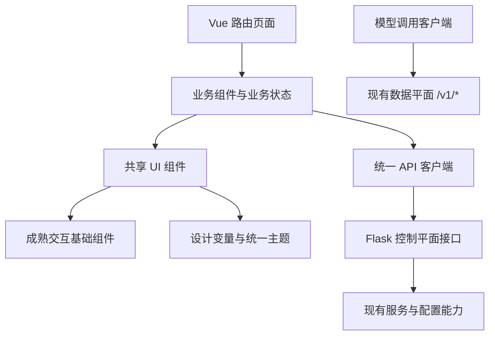

# 全站 Vue 3 改造目标与验收方案

制定日期：2026-11-06。

功能基线：LLM_Proxy `2.3.0`，提交 `764496569a06d55922477035bc19d53d66f6fd32`。执行时同时纳入基线之后已经确认的功能变更。

本文定义完整交付目标。实际实现与验证状态记录在 `docs/frontend-migration-audit.md`，运行架构与部署记录在 `docs/architecture-4plus1.md`。

## 1. 可直接用于执行的总目标

> 将 LLM_Proxy 全部前端页面统一迁移到 Vue 3、TypeScript 和 Vite，建立覆盖明暗主题、基础交互和业务场景的共享组件体系，并采用受 macOS 系统设置启发的紧凑、清晰、克制的视觉设计。
>
> 交付范围包括登录、Provider 与 Auth Group 管理、Codex OAuth、模型映射、API Key、Agent 配置、用户管理、统计日志和系统设置，以及公共导航、提示、弹窗、表格和文件编辑器。各页面完整承接现有功能、请求契约、权限规则和用户已经确认的交互。
>
> Flask 继续提供同源页面入口、静态资源、管理 API 和现有数据平面。生产运行使用预构建的前端资源，Python 服务仍为部署入口。
>
> 整套页面迁移、组件复用、视觉验收、行为回归、构建部署、旧代码清理和文档更新全部完成后交付。实施任务按依赖顺序推进，完成标准以整个后台为单位。

## 2. 交付边界

- 全部页面使用同一套 Vue 应用外壳、路由、主题、基础组件和 API 客户端。
- 现有页面 URL、配置文件、数据库和管理 API 的业务语义保持兼容。
- `/v1/chat/completions`、`/v1/responses`、`/v1/messages`、`/v1/models` 及模型路由继续由现有数据平面负责。
- 本目标中的 Python 变更集中在前端入口、界面上下文、资源装配和相应测试；确有必要的 API 适配逐项记录。
- 全站视觉与交互完整覆盖浅色和深色主题、错误、空数据、加载中、禁用和长文本状态。
- 交付物包含可运行应用、构建资源、组件展示页、测试证据和维护文档。
- 本文所列阶段是同一个目标内部的执行顺序，每个页面的完成状态最终汇总到同一份验收清单。

## 3. 全页面功能清单

实施开始时，将下表展开为逐项功能清单，记录对应旧实现、API、新组件和回归用例。

| 页面与入口 | 完整承接的主要能力 | 重点验收 |
| --- | --- | --- |
| 登录 `/login` | 登录表单、认证错误、已登录跳转、认证关闭时的入口行为 | Cookie 会话、重复提交、会话失效、键盘提交 |
| Provider `/`、`/providers` | 新增编辑、排序、复制、启停、批量操作、导入导出、模型获取与测试、配置与 Hook 路径设置 | 表单快照测试、模型详情、长模型名、保存校验、批量结果 |
| 同页 Auth Groups | Auth Group 与 Auth Entry 编辑、认证条目导入、运行态查看、错误详情、并发与配额相关配置 | 嵌套编辑、条目切换、运行状态、导入错误、删除确认 |
| OAuth `/oauth` | Codex 登录与回调、文本与图片模型目录、认证文件、额度、重置卡、筛选分页、导入导出、批量启停删除 | 当前 Codex 单页布局、轮询生命周期、额度刷新规则、重置卡操作 |
| 模型映射 `/model-mappings` | 映射编辑、目标选择、策略、优先级、排序、启停、导入导出和批量操作 | 不可用目标显示、功能开关、候选选择与保存 |
| API Key `/api-keys` | 创建编辑、模型权限、Token 配额、复制、启停、删除 | 凭据显示、权限选择、配额与错误状态 |
| Agent `/agents` | 本机与 SSH 机器、代理连接、Claude/Codex/opencode、自定义路径、参数设置、保存预览、文件编辑与备份 | 第 8 节全部行为契约 |
| 用户 `/users` | 添加编辑、IP、白名单、模型权限、批量操作、导入导出 | 单个与批量权限、筛选后的选择范围、表格布局 |
| 统计 `/statistics` | 日期与模型等筛选、用户与 Key 用量、调用汇总、请求日志、排序分页、统计导出与数据导入 | 查询参数、列宽、空数据、数据格式和导出内容 |
| 设置 `/settings` | 基础设置、后台认证、客户端 IP、API Key 开关、模型映射开关、OAuth 网络设置、Debug 与现有选项 | 分组保存、字段错误、认证变化后的会话处理、导航同步 |
| 公共外壳 | 导航、当前用户、版本号、退出登录、主题切换、页面标题和工具栏 | 所有页面一致、刷新与历史导航、功能开关及时生效 |

`/logout` 与 `/api/logout` 保留现有兼容行为。OAuth 前端展示范围为 Codex；Claude OAuth 后端接口继续按既有契约提供服务。

## 4. 技术方案与职责

### 4.1 统一技术栈

| 用途 | 方案 |
| --- | --- |
| 页面与组件 | Vue 3 Composition API、单文件组件 |
| 类型 | TypeScript，开启严格检查 |
| 构建 | Vite；Node.js 24 与 npm；依赖通过 `package-lock.json` 锁定 |
| 路由 | Vue Router，沿用现有页面路径 |
| 跨页面状态 | Pinia，仅承载会话、功能开关、主题及确需共享的状态 |
| 浮层等基础交互 | Reka UI，统一封装后供业务使用 |
| 表格能力 | `@tanstack/vue-table`，由共享表格组件提供排序、选择和列宽等能力 |
| 图标 | `@lucide/vue`，通过统一图标入口设置尺寸与线宽 |
| 文件编辑器 | 现有 Ace 依赖，通过统一 Vue 包装组件提供生命周期和主题同步 |
| 样式 | CSS 设计变量、组件样式与受约束的页面布局样式 |
| 单元与组件测试 | Vitest、Vue Test Utils |
| 浏览器回归 | Playwright，配合截图、交互及可访问性检查 |
| 规范检查 | ESLint、Stylelint、Prettier、`vue-tsc` |

依赖版本在实施时核对兼容性、许可证及维护状态，固定为可复现的组合。新增依赖在组件基础设施内完成接入。

### 4.2 目录与依赖方向

```text
frontend/
  AGENTS.md                  前端开发约束与完成检查
  package.json
  package-lock.json
  src/
    main.ts
    app/                     应用外壳、路由、启动
    api/                     统一请求客户端与各领域接口
    stores/                  会话、功能开关、主题
    styles/                  tokens、reset、全局基础样式
    components/
      ui/                    通用交互和视觉组件
    features/
      providers/             Provider 与 Auth Group 业务组件、状态
      oauth/
      model-mappings/
      api-keys/
      agents/
      users/
      statistics/
      settings/
    pages/                   路由页面，组合业务组件
    dev/                     正式组件的展示与验收页面
  tests/
    unit/
    e2e/
    visual/
src/presentation/
  templates/app.html         Vue 页面入口
  static/app/               带内容哈希的生产构建资源及 manifest
```



- `components/ui` 接收属性、插槽和事件，业务请求由 `api` 与 `features` 组织。
- 页面负责组合、布局与路由参数；业务组件负责领域交互；基础组件负责通用行为。
- 表单草稿、加载状态和文件编辑器状态归属于对应业务模块。
- 共用样式和状态通过组件接口表达。新增组件以可说明的复用边界为依据。

### 4.3 同源入口与会话

- Flask 为已知页面路由提供应用入口，服务器保留现有认证、功能开关和 Agent 页面访问边界。
- Vue Router 负责站内导航；直接打开、刷新、前进和后退均落到正确页面。
- 页面入口按明确的页面路径装配；API、代理接口和静态资源继续使用各自的路由与错误响应。
- 增加轻量 `/api/ui/bootstrap`，仅提供应用版本、当前用户、认证状态、功能开关和当前请求允许访问的界面能力。
- 具体业务数据继续从对应接口获取，Agent 文件管理继续经过原有保护链路。
- 登录表单可在未认证状态加载；后台初始化遇到会话失效时转到登录流程。登录凭据错误在表单内展示。
- 认证设置变化引发会话失效时，前端按后端返回结果完成导航和状态清理。

## 5. 统一视觉目标

视觉参考为 macOS 系统设置及桌面工具界面：紧凑、层次清楚、对齐准确、控件反馈稳定。界面内容服务于模型和配置管理。

### 5.1 设计变量

以下作为实施起始规范，调整时在全局设计变量中统一变更，并记录视觉验收结果。

| 语义 | 浅色 | 深色 |
| --- | --- | --- |
| 页面背景 | `#F5F5F7` | `#18181B` |
| 内容表面 | `#FFFFFF` | `#222225` |
| 浮层表面 | `#FFFFFF` | `#2C2C30` |
| 主要文字 | `#1D1D1F` | `#F5F5F7` |
| 次要文字 | `#606068` | `#A1A1AA` |
| 主要按钮填充 | `#0066CC` | `#0A66D8` |
| 主要按钮文字 | `#FFFFFF` | `#FFFFFF` |
| 链接与强调文字 | `#0066CC` | `#78ADFF` |
| 边框 | `#D9D9DE` | `#3A3A40` |

- 成功、警告、危险、选中、悬停、禁用和焦点均使用语义变量。
- 正文和标签的文字对比度达到 WCAG AA；状态同时通过文字或图标表达。
- 字体使用系统字体栈，macOS 使用系统界面字体，Windows 使用 Segoe UI 与适用的中文系统字体。模型 ID、路径和代码使用等宽字体，数值采用等宽数字。
- 正文与控件文字以 13–14px 为主，辅助说明 12px，分组标题 15–16px，页面标题 20–24px。
- 间距以 `4 / 8 / 12 / 16 / 24 / 32px` 为统一尺度。
- 紧凑控件高度 32px，标准控件高度 36px；触屏场景按可访问性要求扩大点击区域。
- 控件圆角 8px，内容分组 12px，弹窗 16px；状态徽标和分段控件使用专用规范。
- 内容层级主要通过间距和表面明度区分，菜单、提示和弹窗使用统一阴影。
- 动效持续时间 120–180ms，支持 `prefers-reduced-motion`。

### 5.2 布局与主题

- 顶部统一导航、页面标题与工具栏形成固定外壳，导航顺序与现有入口保持连续。
- Agent 页面保留本机/SSH 机器侧边栏；系统设置保留清晰的设置分组。
- 桌面布局提供一致的内容宽度和内边距，密集表格使用可控的横向滚动。
- 表单提供统一的单列、双列和四列布局规则，标签、帮助图标、错误信息和输入区域对齐。
- 主题继续使用 `localStorage.theme` 的现有偏好，现有默认深色行为保持连续。
- 首屏主题在绘制前应用，浮层、代码编辑器和路由切换同步使用当前主题。
- 在 1920、1440、1024 和 390px 宽度下检查布局。窄屏表单依次收为双列或单列，页面主体保持可阅读。

## 6. 基础组件清单与统一交互

| 组件族 | 统一职责 |
| --- | --- |
| `UiButton`、`UiIconButton` | 主次操作、危险操作、尺寸、图标、加载和禁用 |
| `UiField` | 标签、必填、帮助、单位、说明和字段错误 |
| `UiInput`、`UiNumberInput`、`UiSecretInput` | 输入、数值提交、显隐、清空和键盘行为 |
| `UiSelect`、`UiCombobox` | 固定选择、搜索选择、可输入候选、长选项和二级说明 |
| `UiCheckbox`、`UiSwitch`、`UiTriState` | 多选、布尔值及启用/禁用/不设置 |
| `UiTabs`、`UiSegmented` | 页内分区、当前选择、键盘切换 |
| `UiTooltip`、`UiHelpPopover` | 简短提示与富文本说明，统一悬停、焦点和定位 |
| `UiDialog`、`UiConfirmPopover` | 弹窗、确认、焦点管理和关闭钩子 |
| `UiToast`、`UiAlert`、`UiEmptyState` | 操作反馈、页面错误、空数据和加载状态 |
| `UiTable`、`UiPagination` | 表头、行选择、列宽、排序、分页和溢出 |
| `UiBadge`、`UiStatus` | 文件、连接、额度、启用等状态呈现 |
| `UiCodeEditor` | Ace 装配、语言、主题、内容、只读和销毁 |

具体约定：

- 问号说明支持鼠标悬停与键盘聚焦，鼠标移入说明区域后保持显示；统一使用约 120ms 打开和 160ms 关闭延迟。
- 下拉菜单统一浮层定位、宽度策略、滚动、选中、禁用和键盘行为。选项可通过插槽包含数值、模型名与来源说明。
- Tooltip 用于简短文本，包含可交互内容的说明使用 HelpPopover。
- 弹窗统一处理焦点进入、焦点约束、关闭后焦点恢复、Escape 和点击遮罩；业务通过关闭钩子处理未保存内容。
- 字段缺失与格式错误直接标记到对应输入项，错误图标和文字使用危险色。
- 数值组件明确区分空值、合法零值和未设置状态，转换与提交规则由业务声明。
- 持续输入只更新必要的字段状态；需要提交才计算的字段使用 `commit` 事件。表单更新保留输入焦点、光标、菜单和滚动位置。
- 请求结果按请求标识关联当前草稿，迟到的响应只作用于它对应的状态。
- 业务行使用稳定 ID 作为组件 key，文件编辑器按打开对象管理实例生命周期。

## 7. 业务复用与持续约束

### 7.1 共享业务能力

- `ModelSelect`：模型目录、完整 ID、搜索、外部地址手填及模型说明。
- `ModelPermissionPicker`：用户和 API Key 的模型权限选择；不同业务的差异通过明确参数表达。
- `ApiKeyField`：掩码、显隐、已有 Key 候选与手动输入。
- `ModelParameters`：参数候选、来源模型、上下文/压缩/输出和计算值。
- `ConfigPathRow`：文件状态、文件名、可点击路径与自定义路径入口。
- `ConfigFileEditor`：文件读取、语言高亮、备份选择、保存状态与关闭确认。
- `ProxySettings`：共用代理字段和校验，各业务保留自己的可选模式与默认规则。
- 复制、下载、上传、分页、行选择、字段错误映射和请求状态使用公共函数或组合函数。

### 7.2 统一 API 客户端

- 请求使用同源 Cookie，统一处理 JSON、文件上传、下载、错误信息和取消信号。
- `api/agents` 为 Agent API 附加现有 `X-Agent-Config: 1`，继续使用浏览器隔离会话。
- API 类型按实际接口建立；后端校验结果保留并映射到页面。
- 原始 fetch 调用集中在 API 层，业务模块通过类型化接口访问。
- 定时刷新按页面和操作状态启动、暂停与销毁；Codex 额度刷新遵循 `docs/codex-quota-refresh.md`。
- 主题等非敏感偏好按既有键名兼容；会话凭据、API Key 和 SSH 密码按现有生命周期处理。

### 7.3 代码约束

- 业务通过 `components/ui` 的统一出口使用基础组件；交互基础库的直接导入限定在包装层。
- 图标通过统一入口使用，组件图标的描边、大小和对齐由公共规范控制。
- 页面 CSS 负责布局，基础控件的视觉变体在组件内维护。
- 颜色、阴影、层级和常规尺寸引用设计变量，静态检查覆盖新增业务样式。
- 受控内容通过 Vue 模板和插槽渲染；确需渲染 HTML 的场景使用审查后的边界与净化方式。
- `frontend/AGENTS.md` 记录组件选择规则、样式边界、接口使用约定和交付检查命令。
- 组件展示页直接渲染正式组件，包含浅色/深色、默认/悬停/聚焦/禁用/错误/加载及长文本示例。
- 展示页服务开发和测试，生产构建明确控制其可达性。

## 8. Agent 页面行为契约

以下是已经确认的产品行为，也是迁移完成的必要条件：

1. 左侧默认本机，支持新增、选择、编辑和删除 SSH 机器；远程配置在连接成功后可编辑。
2. SSH 支持现有密码/密钥能力、主机指纹确认及 HTTP、HTTPS、SOCKS 代理模式，密码和代理信息保持既有会话边界。
3. 文件行从左到右呈现存在状态、文件名、路径，路径设置入口位于行尾；打开文件的点击范围限定为路径文字区域。
4. Claude、Codex、opencode 均支持按机器持久保存自定义路径；默认路径、恢复默认及 Codex 两文件目录关联沿用现有规则。
5. API 地址与 API Key 同行。本服务地址使用模型目录，外部地址使用手填模型 ID。
6. API Key 候选支持选择已有 Key 与手填，焦点进入、点击输入和移入候选时保持稳定。浏览器自动填充行为使用现有抑制策略并进行实际检查。
7. Claude 的一键设置模型位于模型分组之前；统一输入同步到各模型，存在不同值时统一输入显示为空。
8. 模型区域保持紧凑分组，模型选择一行两个；问号行为由共享帮助组件提供。
9. 参数候选在说明中包含参考模型名；主模型为空且配置了多个模型时列出对应候选。未知模型、别名及 Provider 参数优先级沿用现有逻辑。
10. 思考强度位于模型上下文相关设置之前。上下文、压缩阈值和最大输出使用同一套数值输入与候选菜单。
11. Codex 压缩上限与 opencode 压缩预留显示在压缩阈值标题旁；数值输入失焦且值变化时提交，下拉候选选择即时提交。
12. 未改动的百分比继续保留原配置中的精确 Token 值；空值、移除字段及不设置状态保持可区分。
13. 运行设置使用统一的四列布局规则，按可用宽度收拢；已有三态配置保留字段含义和写入规则。
14. 文件缺失时使用现有的新建默认值；已有文件缺少某项时显示不设置。Codex 保留 memories 选项，其他已确定的功能范围沿用基线。
15. 单个字段变化局部更新保存预览，页面布局、输入焦点、光标和滚动保持稳定。
16. 原始文件编辑支持 JSON、JSONC、TOML 高亮及备份读取；有改动时关闭编辑器提供保存、放弃和继续编辑。
17. 文件编辑器一次保存完成现有预览校验与票据写入，冲突或失败时保留编辑内容。
18. 页面离开行为延续已确认的交互；未保存确认集中在原始文件编辑器等已明确要求的流程。
19. 缺失的 SSH 等必填字段在对话框内标红，错误标识使用红色。
20. 明暗主题覆盖表单、候选菜单、帮助浮层、机器对话框和文件编辑器。

配置语义继续以 `agent_config_documents.py`、模型参数表及对应测试为依据。前端迁移完整承接业务规则。

## 9. 构建与部署

- 前端源码位于 `frontend/`，生产资源输出到 `src/presentation/static/app/`，通过 Vite manifest 定位入口与依赖。
- 交付提交同时包含前端源码、锁文件和生产构建资源。当前仓库部署方式继续支持取得代码后启动 Python 服务。
- Node.js 用于开发、测试和构建；生产请求由现有 Flask + gevent 进程提供服务。
- 生产资源使用内容哈希；HTML 入口与资源缓存策略分别设置，更新版本后加载对应资源。
- 页面按路由拆分，Ace 等较大依赖按需要加载；界面资源从本服务提供。
- 开发模式通过明确的同源代理路径访问 Flask，Agent API 的 Origin、Cookie 与专用请求标识通过集成检查。
- 资源构建目录由专用脚本管理。Windows 文件操作使用 `pwsh.exe`，清理操作限定到已经解析并验证的构建目录。
- 依赖安装、构建、产物检查和后端启动步骤记录在 README；全新检出环境验证流程可复现。
- 版本号继续以 `pyproject.toml` 为权威来源，界面通过启动上下文展示实际服务版本。

## 10. 实施顺序与交付物

| 顺序 | 工作 | 完成产物 |
| --- | --- | --- |
| 1 | 全页面功能、接口、状态与测试盘点 | 功能对应表、关键截图、请求与交互基线 |
| 2 | 前端工程、Flask 入口、路由与会话装配 | 可构建的 Vue 应用、类型化客户端、部署脚本 |
| 3 | 设计变量、外壳、基础组件和展示页 | 完整主题与控件状态、共享交互测试 |
| 4 | 全部页面与业务组件迁移 | 第 3 节所有页面及第 8 节全部 Agent 行为 |
| 5 | 跨页面一致性、异步行为与响应式验证 | 浏览器回归结果、截图与缺陷处理记录 |
| 6 | 旧实现与依赖清理、生产构建、文档更新 | 单一生产前端实现、可部署产物、最终验收记录 |

第 4 步建议内部依次完成 Agent/设置、用户/API Key、模型映射、Provider/Auth Group、OAuth、统计；登录与公共外壳随第 2–3 步建立并在最终回归中覆盖。

旧实现清理清单：

- 各业务 Jinja 模板中的界面实现和内联业务脚本完成对应迁移后退出生产入口。
- 原有页面专属 CSS 中的通用控件规则由共享组件承接，剩余布局进入对应 Vue 页面。
- Bootstrap 的生产依赖在组件替换完成后清理。
- 旧主题、消息提示、表格列宽和浮层脚本的能力进入共享实现，调用点与资源引用同步清理。
- Ace 作为文件编辑器依赖保留，其业务装配统一经过 Vue 包装层。
- `_theme_bootstrap.html`、旧基础模板和旧测试的保留与删除依据实际引用及功能对应表执行。

## 11. 验证方案

### 11.1 功能与接口

- 当前基线包含 799 项 Python 测试和 39 项前端交互用例。测试按业务行为建立迁移对应关系，数量作为基线记录。
- 现有 API、配置读写、数据平面、OAuth、认证、SSH 及并发相关测试全部通过。
- 原来检查旧模板字符串的用例迁移为组件渲染、接口契约或浏览器行为验证，并记录对应关系。
- 前端组件测试覆盖三态、选择器、字段提交、精确压缩值保留、未保存关闭确认与异步响应顺序。
- E2E 覆盖所有页面的主要操作，认证开启/关闭、功能开关、会话失效、失败重试和文件冲突。
- 文件与 SSH 测试使用隔离的临时配置和受控服务；构建回归使用独立测试数据。

### 11.2 视觉与交互

- 全部页面在 1440px 下保留浅色与深色基线截图；密集表格、Agent 页面、设置和关键浮层补充 1920、1024、390px 检查。
- 按钮、输入、下拉、问号、弹窗、分页和状态标签在各页面使用相同的基础组件与设计变量。
- 长模型 ID、长路径、空数据、错误内容、大列表及加载状态均有覆盖。
- Tab 顺序、Enter/Space、方向键、Escape、弹窗焦点恢复与可见焦点通过实际交互验证。
- 检查字段编辑期间的光标、页面滚动、预览位置和文件编辑器状态。
- 浏览器检查在可运行的开发或 CI 环境中执行，并保存截图和结果；完成状态以实际验证结果为依据。

### 11.3 性能与生命周期

- 路由初次进入加载对应页面资源，代码编辑器按需要加载。
- 页面离开后释放相应定时器、监听器、未完成请求与编辑器实例。
- 主题切换、开关控件和数值输入保持即时响应；局部变更更新对应组件。
- 重复进入页面保持正确的事件数量，OAuth 轮询与参数预览请求按既定规则执行。
- 数据平面在后台页面编辑、配置读取和 SSH 操作期间保持既有独立性。

### 11.4 统一检查命令

实施时在 `package.json` 中提供以下稳定入口，并在 CI 或等效验证脚本中调用：

```text
npm --prefix frontend ci
npm --prefix frontend run lint
npm --prefix frontend run typecheck
npm --prefix frontend run test:unit
npm --prefix frontend run build
npm --prefix frontend run test:e2e
npm --prefix frontend run test:visual
uv run python -m unittest discover -s tests
uv run python scripts/check_agent_model_limits.py
```

Python 修改按仓库约定执行 Ruff import 整理和格式化。全部文本使用 UTF-8 无 BOM 与 LF。构建资源与源码的一致性纳入交付检查。

## 12. 完成定义

- [x] 登录与全部后台页面均使用 Vue，现有入口和深链接正常。
- [x] 第 3 节功能对应表中的项目全部有可运行实现与验证结果。
- [x] 第 8 节 Agent 行为契约全部通过。
- [x] 通用控件统一来自共享组件，展示页与业务页面使用同一份实现。
- [x] 浅色、深色、控件状态、响应式与长文本检查全部完成。
- [x] 组件、浏览器、接口、后端回归和模型表检查全部通过。
- [x] 会话、功能开关、文件管理边界与数据平面行为符合既有契约。
- [x] 生产构建资源可由 Flask 加载，全新检出与既有部署更新流程验证通过。
- [x] 旧生产页面实现、重复交互代码、重复控件样式和失效资源引用完成清理。
- [x] README、组件规范、前端开发约束、测试说明和 4+1 架构文档反映最终实现。
- [x] 最终说明列出实际交付页面、复用组件、执行的检查及验证证据。

上述项目全部完成即达到本次“全站一次性交付”的目标。
