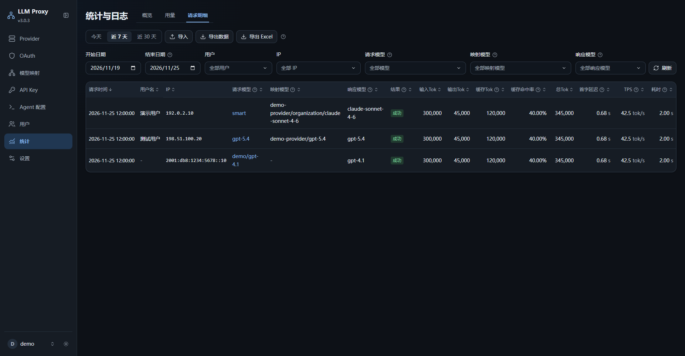
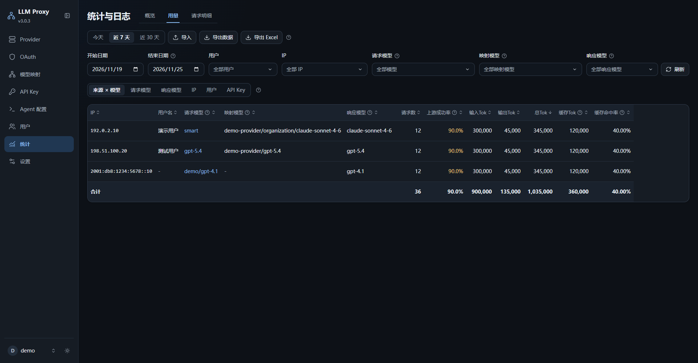

# 统计与请求观测口径

本文定义统计指标与数据边界。页面组件和请求链路见 [4+1 架构](architecture-4plus1.md)。

## 1. 页面与筛选

统计页面包含概览、用量和请求明细，共用日期、用户、请求模型、映射模型、响应模型和 IP 筛选。模型筛选按请求模型、映射模型、响应模型排列，支持多选，各类条件同时生效。日期使用浏览器本地日期，筛选和导出使用同一组已应用条件。“刷新”按钮紧邻响应模型筛选框右侧，在窄屏下与该筛选框保持同组，更新当前视图数据并保留筛选、排序与分页。

- 概览：请求数、Token、上游成功率、缓存命中率、首字延迟、TPS 和时间趋势。使用趋势折线图默认展示 Token 用量，支持切换请求数、上游成功率和缓存命中率。
- 用量：按来源 × 模型、请求模型、响应模型、IP、用户或 API Key 分组，支持合计和 Excel 导出。
- 请求明细：展示单次客户端请求的模型流向、用户名、IP、结果、Token、缓存、首字延迟、TPS 和总耗时，用户名与 IP 独立成列。

趋势图按日期范围显示可选时间粒度：单日可选“5分钟”“小时”“天”，2 至 7 天可选“小时”“天”，超过 7 天仅显示“天”。日期范围变化后默认选择当前范围最细的粒度。修改其他筛选保留手动选择；切换粒度保留当前指标和筛选，仅重新读取概览数据。横轴显示简短日期和时间，悬停或聚焦显示完整时段起始时间。

`GET /api/statistics/overview` 接收可选的 `interval=auto|5m|1h|1d`。省略参数时按天返回；`auto` 按单日、2 至 7 天和更长范围分别选择 5 分钟、小时和天。`5m` 仅支持单日，`1h` 支持最多 7 天，超出范围返回 400；页面显式传入选中的 `5m`、`1h` 或 `1d`。`series_interval` 返回实际粒度，`series_partial` 标识细粒度趋势存在缺少时间明细的历史用量。分钟和小时按 `request_logs.start_time` 对齐到时段起点，时段包含起点、不含终点，当前时间以后的时段不生成趋势点；空时段的请求数与 Token 为 0，无可计算样本的比例为未知。上游重试按客户端请求开始时间归入同一时段，Token 每次客户端请求只累计一次。

来源 × 模型、请求模型用量、请求明细及其 Excel 导出分别使用请求模型、映射模型、响应模型三列。请求模型显示客户端传入的原始 ID；映射模型显示实际选中的目标 ID，与请求 ID 相同时也保留，没有映射目标时显示 `-`；响应模型显示上游实际报告的 ID，缺失时归入未知。没有对应用户名时显示 `-`。任一字段不同即形成不同的流向分组；响应模型维度仅按响应 ID 汇总。

映射模型筛选使用 `target_model_id` 参数，多个值重复传参。筛选按请求最终选中的映射目标匹配，匹配请求的全部上游重试均参与成功率计算。`GET /api/statistics/filter-options` 合并请求日志与日聚合中的去重候选，`target_models` 提供非空映射目标 ID。

全部用量维度与请求明细使用自适应列宽和紧凑单元格间距，表头、数据行和合计行使用相同列宽。所有列标题保持完整单行显示，列宽下限包含实际表头文字、说明按钮、排序图标与内边距。数值列按完整数值、单位及合计保留可读下限，Token 保留精确值。用户名列默认宽度为 72px，长用户名完整换行。

IP 列按当前表格已加载数据中最长地址的实际显示宽度与表头宽度取较大值，并计入左右留白；IPv4 与 IPv6 均保持完整单行。请求模型、映射模型和响应模型三列分别按本列最长内容与表头测量所需宽度，短内容列保持紧凑，自动分配达到内容所需宽度时停止扩张；空间不足时按各列内容需求收窄，长模型名完整换行。刷新、筛选与翻页后按当前加载数据重新计算。Key 等弹性文本列按配置分配剩余空间；IP、用户汇总由数值列分配剩余空间。全部弹性列达到上限时，表格使用列宽合计；容器小于各列可读下限之和时，表格内部支持横向滚动。

用量与请求明细的 Token 表头使用“输入Tok”“输出Tok”“缓存Tok”和“总Tok”。Tok 表示 Token；缓存Tok 表示缓存读取 Token，已包含在输入Tok 中。

请求明细的请求时间使用完整 `YYYY-MM-DD HH:mm:ss` 单行显示，默认列宽为 144px；结果列以 80px 为基础。

拖动表头右边界或聚焦边界后按左右方向键可调整列宽，手动宽度在当前浏览器保存并优先于自动分配，同时受表头与内容的可读下限约束；双击对应边界恢复该列的自动宽度。

## 2. 客户端请求与上游调用

客户端请求和上游调用分别计量：

- 一次客户端请求可以包含 Provider 重试、模型映射切换或 OAuth 认证切换，每次实际上游调用独立记录。
- Token 按客户端请求累计一次，不因上游重试重复累加。
- 上游成功率 = 上游成功调用数 ÷（上游成功调用数 + 上游失败调用数）。
- 上游 HTTP 错误和响应错误事件计失败；连接失败、超时、中断和无效响应计异常；客户端或代理提前关闭计中止。异常、中止和代理内部错误不进入成功率分母。
- 请求明细的最终结果按客户端请求记录，与上游成功率分开计算。

`request_logs.upstream_attempts` 保存上游调用的目标模型、响应模型、结果和 HTTP 状态。字段为空表示历史记录未采集调用明细，空数组表示已采集但没有可记录调用。JSON 统计迁移包版本为 6。

## 3. Token 与缓存

- Token 使用上游报告的 usage；已包含在输出中的推理 Token 不重复相加。
- 输入 Token 包含缓存读取 Token，缓存读取不另计入总 Token。
- 缓存命中率 = 缓存读取输入 Token ÷ 已报告缓存明细的输入 Token。
- 缓存请求命中率 = 已知缓存明细中缓存读取大于零的请求占比。
- 缺少缓存明细时显示未知，不按零处理。

## 4. 时间与性能

| 指标 | 定义 |
| --- | --- |
| 首字延迟 | 从代理收到客户端请求，到向下游发出首个非空正文、思考或工具参数片段 |
| TPS | `输出 Token × 1000 / 总耗时毫秒` |
| 总耗时 | 从请求开始到响应结束，包含代理处理、上游重试、思考和末尾用量等待 |

角色、心跳、用量和终止事件不属于首字内容。非流式响应没有流式首字延迟。输出用量缺失、输出为零、总耗时无效或请求失败、取消时，TPS 为空。隐藏思考、单数据块和非流式响应使用同一 TPS 公式。

单条请求在用量已知或部分已知且输出大于零时可以计算 TPS；概览仅对已知成功请求的有效 TPS 求算术平均。历史记录只有起止时间时，总耗时使用两者之差。

## 5. 历史数据

`daily_request_stats` 提供概览总量、各用量维度和按天趋势的历史用量；`request_logs` 提供分钟、小时趋势的用量、请求结果与性能样本。只有日聚合的历史记录不推断分钟或小时分布、结果和性能。分钟或小时趋势的明细覆盖少于对应日期的日聚合用量时，页面提示可切换按天查看完整用量。仅导入请求明细时，其用量可在分钟或小时趋势中查看，概览总量及按天用量使用日聚合记录。

导入统计迁移包时，请求明细按业务字段去重，日聚合按日期、IP、请求模型、映射目标模型和响应模型累加。请求明细与日聚合使用相同筛选条件导出。
